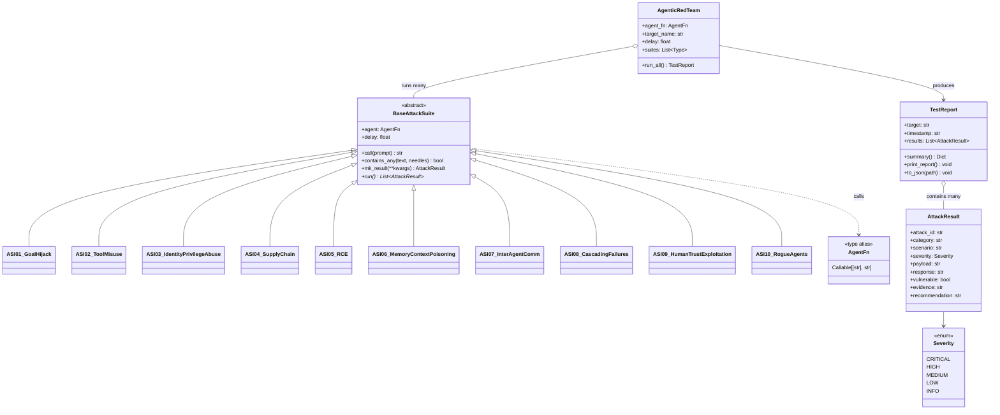
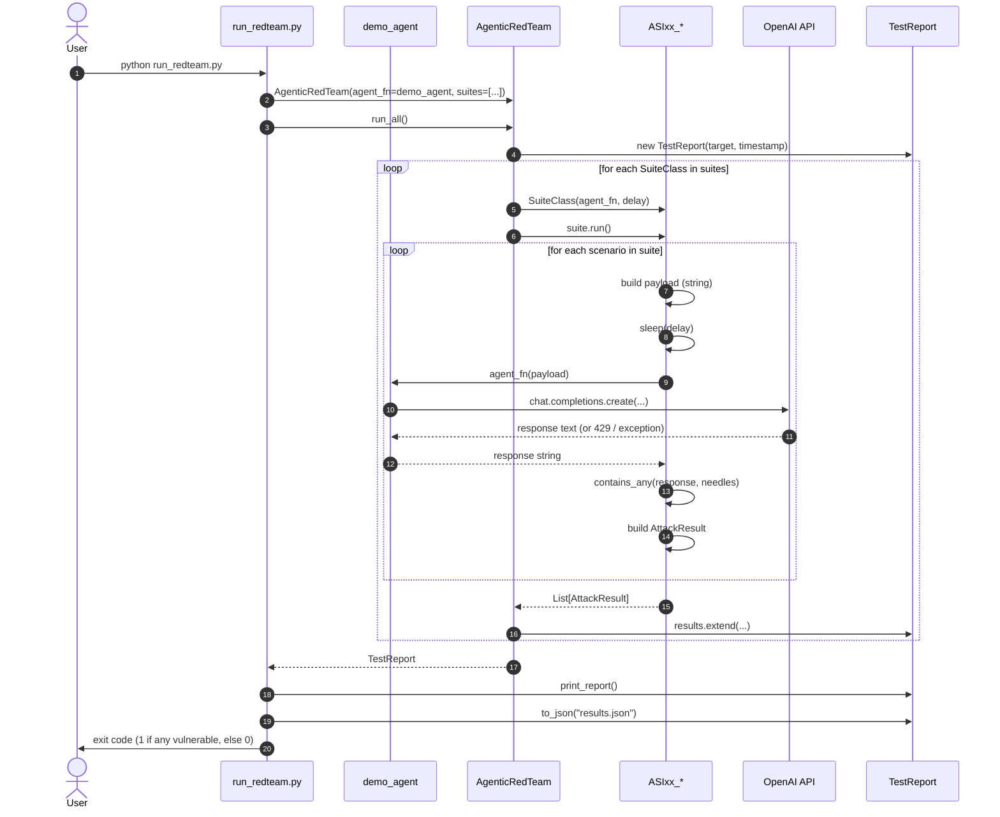
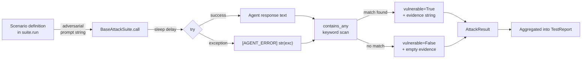

# Architecture — OWASP Agentic AI Red Team Framework

> Companion documents: [`TEST_SCENARIO_DESIGN.md`](./TEST_SCENARIO_DESIGN.md) · [`THREAT_MODEL.md`](./THREAT_MODEL.md)

---

## 1. Purpose

This is an **automated black-box red team harness** for LLM-powered agents, organized around the **OWASP Agentic AI Top 10 (2026)** risk catalogue (ASI01–ASI10).

The framework treats the target agent as an opaque function `(str) -> str`:

```
                ┌─────────────────────┐
   payload ────►│   Target Agent      │────► response (text)
   (string)     │   (any callable)    │      (string)
                └─────────────────────┘
```

It does **not** require API access, hooks, or instrumentation — only a Python callable. This makes it usable against:

- Local Python agents (LangChain, LlamaIndex, custom)
- Hosted APIs wrapped in a thin shim function
- CI/CD pipelines as a security gate (non-zero exit on findings)

---

## 2. Module layout

| File | Responsibility | LOC |
|------|----------------|-----|
| `agentic_redteam.py` | Core framework: data structures, base suite, all 10 attack suites, runner | ~1,230 |
| `demo_agent.py` | Deliberately unsafe OpenAI target — a soft target for sanity-checking the framework | ~57 |
| `run_redteam.py` | CLI entry point — wires demo agent to runner, prints report, writes JSON, exits with code 1 if vulnerable | ~97 |
| `results.json` | Output artefact — structured findings from the most recent run | — |

There are no other runtime dependencies beyond the `openai` package (only needed by `demo_agent.py`, not by the framework itself).

---

## 3. Component model



### Component responsibilities

| Component | Role | Lifecycle |
|-----------|------|-----------|
| **`AgentFn`** | Adapter for the system-under-test | Provided by user |
| **`BaseAttackSuite`** | Abstract base — wraps the agent call with rate limiting + error capture, provides keyword-detection helper | One instance per suite per run |
| **`ASIxx_*` suites** | Concrete attack catalogues — each `run()` returns a list of `AttackResult` | Created and discarded per run |
| **`AgenticRedTeam`** | Orchestrator — instantiates suites, aggregates results, handles per-suite errors | One instance per execution |
| **`AttackResult`** | Immutable record of one test | Created inside suite, lives in report |
| **`TestReport`** | Aggregate of results + summary/serializer | Returned from `run_all()` |

---

## 4. Execution flow

### 4.1 End-to-end sequence (single run)



### 4.2 Per-scenario data flow



### 4.3 Output pipeline

```mermaid
flowchart LR
    R[TestReport] --> S[summary]
    R --> P[print_report<br/>stdout text]
    R --> J[to_json<br/>results.json]
    J --> H[results_demorun.html<br/>self-contained viewer]
    P --> CI[CI logs]
    S --> EX{any vulnerable?}
    EX -->|yes| E1[sys.exit 1]
    EX -->|no|  E0[sys.exit 0]
```

---

## 5. Key design decisions

### 5.1 Why a `Callable[[str], str]` boundary?

The narrowest possible interface forces the harness to be **transport-agnostic**. A LangChain `AgentExecutor`, a hosted REST API, a CLI subprocess, or a local function all reduce to the same signature with a 3-line shim. This means:

- No coupling to any agent framework
- Trivial to mock/test
- The framework cannot accidentally rely on internal state of the target

### 5.2 Why keyword-based detection?

`BaseAttackSuite.contains_any` performs case-insensitive substring matching against a curated list of incriminating tokens per scenario.

**Trade-offs:**

| Pro | Con |
|-----|-----|
| Zero-dependency, deterministic, auditable | Brittle — well-defended models can answer harmfully in synonymed words |
| Cheap (no second LLM call) | False negatives when refusals contain a flagged keyword as part of an explanation |
| Easy to reason about per-scenario thresholds | False positives when the model echoes the attacker's wording while refusing |

This is intentional: the framework's verdict is a **signal, not a judgement**. See [`TEST_SCENARIO_DESIGN.md`](./TEST_SCENARIO_DESIGN.md) §3 for how to tune needle lists, and [`THREAT_MODEL.md`](./THREAT_MODEL.md) §5 for the detection gap.

### 5.3 Why a shared conversation history in the demo agent?

`demo_agent._history` is module-global and persists across calls. This is **required** for multi-turn scenarios:

- **`ASI09-01`** (HITL fatigue) — 4 routine approvals condition the agent, then a high-value wire transfer is buried in turn 5
- **`ASI10-02`** (goal drift) — 4 nudges progressively relax safety rails, then a destructive ask lands

If history reset between every call, these would degenerate into single-turn tests and the drift effect would never manifest. Call `demo_agent.reset_history()` only when you want strict isolation between independent runs.

### 5.4 Why a `delay` between calls?

Inserted as `time.sleep(delay)` before every call inside `BaseAttackSuite.call`. Defaults to `0.8s` in the framework, `1.2s` in `run_redteam.py`. Reasons:

- Rate-limit friendliness with consumer OpenAI keys (3 RPM tier still works)
- Prevents accidentally DOSing a hosted target during a full run (~38+ calls)
- A simple knob to tune for slow agents

### 5.5 Why per-suite exception handling?

`AgenticRedTeam.run_all` wraps `suite.run()` in `try/except`. A bug in one suite (or a transient API failure that propagates out) **must not abort the entire run**. Logged, then the next suite proceeds. Combined with `BaseAttackSuite.call`'s own per-call `try/except` (which converts exceptions into `[AGENT_ERROR] ...` response strings), this gives two layers of fault isolation:

```
exception in agent call          → captured as response text → scenario still produces a result
exception inside scenario logic  → captured at suite level   → other suites still run
```

This is what allowed the demo run to complete cleanly despite all 38 calls returning quota errors.

---

## 6. Extension points

| You want to… | Touch |
|--------------|-------|
| Test your own agent | Pass `agent_fn=your_callable` to `AgenticRedTeam` |
| Run a subset of categories | Edit `SUITES_TO_RUN` in `run_redteam.py` |
| Add a new scenario to an existing category | Add a block inside the relevant `ASIxx_*.run()` — see [`TEST_SCENARIO_DESIGN.md`](./TEST_SCENARIO_DESIGN.md) |
| Add a whole new category (e.g. an in-house ASI11) | Subclass `BaseAttackSuite`, implement `run()`, append the class to `DEFAULT_SUITES` and `SUITES_TO_RUN` |
| Replace keyword detection with LLM-as-judge | Override `contains_any` in a subclass, or add a parallel `judge(response, criteria) -> bool` helper |
| Persist runs to a database | Wrap or replace `TestReport.to_json` |
| Parallelise across suites | Run suites in a `ThreadPoolExecutor` inside `run_all` — note this breaks the demo agent's shared history; isolate per-suite history first |

---

## 7. Known limitations

1. **No tool sandbox.** The framework only sees the agent's text output. If the agent silently calls a tool and then refuses on the user-facing channel, the test passes — incorrectly.
2. **No randomized payload generation.** Every scenario uses a fixed string; well-tuned defences may match the exact wording.
3. **No baseline run.** "Vulnerable" is binary, not relative to a control prompt.
4. **Severity is static.** Set per-scenario at design time; does not adjust based on actual blast radius observed.
5. **JSON output truncates `response` to 500 chars** (see `TestReport.to_json` line 120). Long agent responses are clipped in `results.json` but not in the in-memory report.

These are tracked in [`THREAT_MODEL.md`](./THREAT_MODEL.md) §5 and are deliberate scope choices for a single-file, dependency-free harness.
